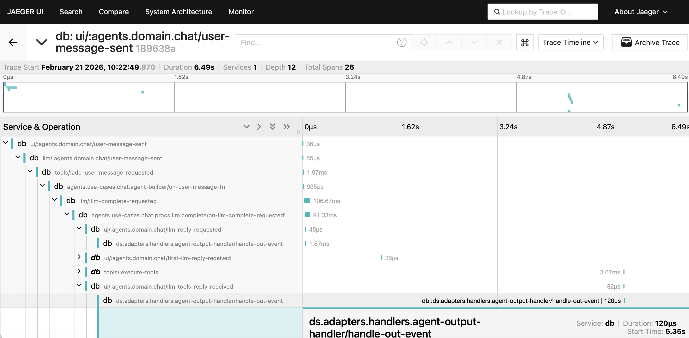

# AI TodoMVC Agent

An AI agent that helps you manage your todo list. Built on top of the popular [TodoMVC](http://todomvc.com/) app, you can manage todos the classic way (add, edit, toggle, delete in the UI) or via natural conversation—"Add buy milk and walk the dog," "Mark buy milk as done"—both on the same list.

<video src=".docs/media/todomvc_ai_agent_demo.mp4" controls width="100%"></video>

## 🎬 Demo

<p align="center">
  <a href="https://youtu.be/8aHSc9F6aws">
    
  </a>
</p>

The UI is server-rendered with [Datastar](https://data-star.dev/) through the [taia.ds](https://cljdoc.org/d/io.github.danbunea/taia.ds/0.2.0/doc/readme) library: components and their state machines live in `components/datastar/src/ds/adapters/components`, and the request pipeline, SSE push and `datastar.js` come from the library.

---

## Prerequisites

- **JDK 21+** – the app uses virtual threads
- **OpenAI API key** – set the `OPENAI_API_KEY` environment variable

---

## Getting Started

### Start the server

```bash
bb dev
```

or:

```bash
clj -A:dev -X dev/-main
```

Then open the app at **[http://localhost:7777](http://localhost:7777)** (the same page is also served at `/ds/nds/todomvc.todomvc-page/t/init`).

### Start the server from the REPL

Open `development/src-dev/dev.cljc` in your editor, connect your REPL to the `dev` namespace, then evaluate `(-main)` to start the server.

### Run tests

```bash
bb test
```

### Run the end-to-end tests

Playwright suites in `e2e/` (needs Node 18+). Each command installs the Playwright deps, starts its own copy of the app on port 7799 (so it can run next to `bb dev`), runs the specs and stops the app:

```bash
bb e2e-test
```

The UI suite (`e2e/tests`): the classic TodoMVC flow and the chat panel, with no LLM calls. Any browser console error fails a test.

```bash
bb agent-e2e-test
```

The agent suite (`e2e/tests-agent`): real OpenAI calls (needs `OPENAI_API_KEY`), asserting on outcomes such as the todo list and the chat turn finishing, not on the model's wording.

Pass a spec name to run one file, and `--headed` to watch: `bb e2e-test todomvc --headed`. Each test runs as its own user (a `dev-user` cookie), so tests never share a todo list. The app's output goes to `e2e/server.log`.

### View traces (optional)

To inspect traces, run Jaeger in Docker first, then start the app. Traces are sent to Zipkin (`http://localhost:9411`) and viewable in the Jaeger UI at [http://localhost:16686](http://localhost:16686):

```bash
docker run --rm --name jaeger \
  -e COLLECTOR_ZIPKIN_HOST_PORT=:9411 \
  -p 6831:6831/udp -p 6832:6832/udp -p 5778:5778 \
  -p 16686:16686 -p 4317:4317 -p 4318:4318 -p 14250:14250 \
  -p 14268:14268 -p 14269:14269 -p 9411:9411 \
  jaegertracing/all-in-one:1.56
```

The Jaeger UI will be available at: [http://localhost:16686](http://localhost:16686)


